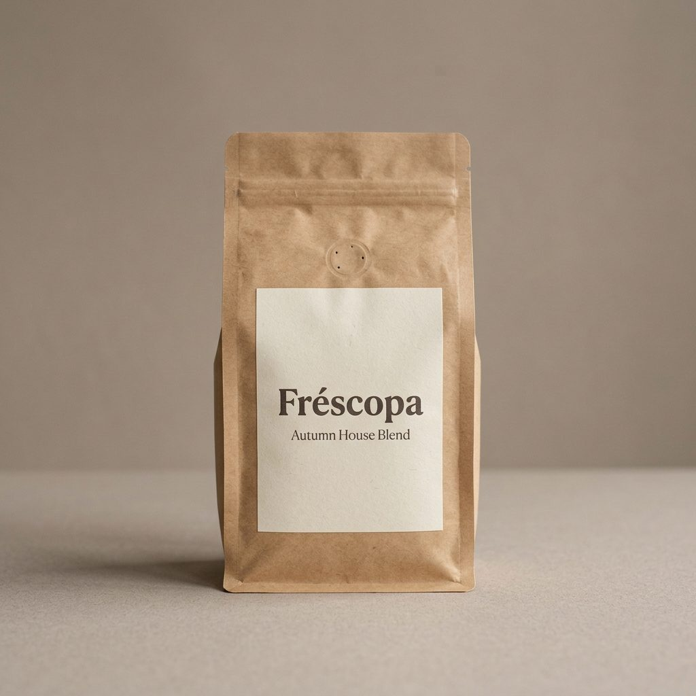
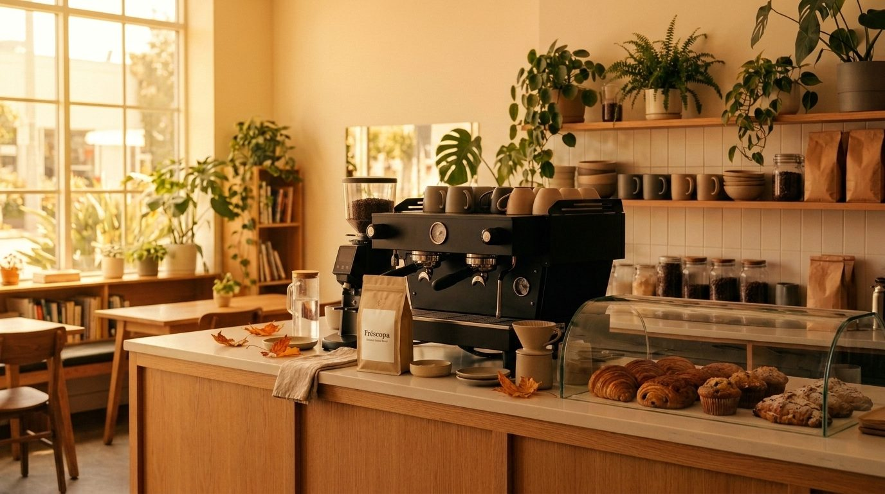
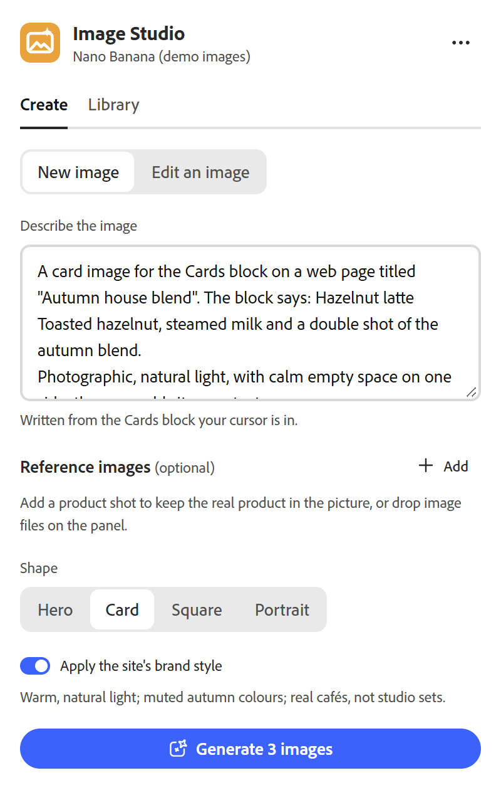
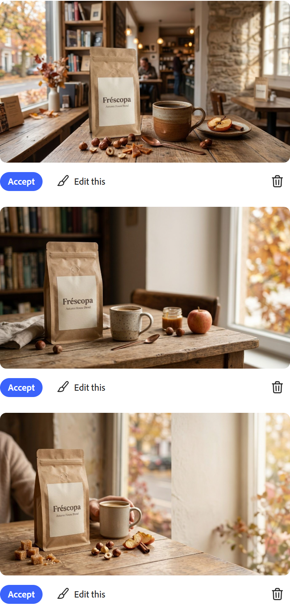
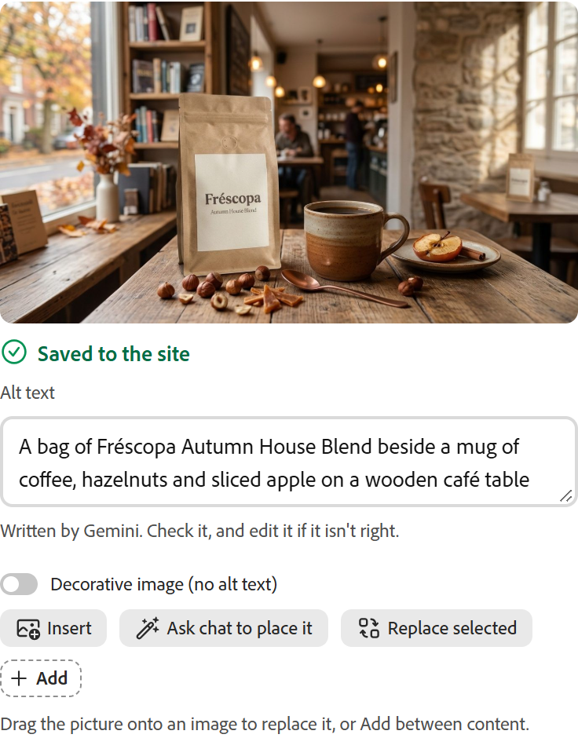
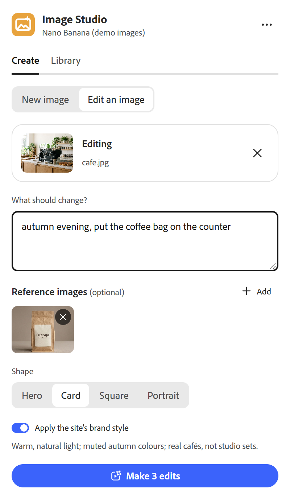
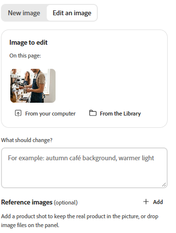
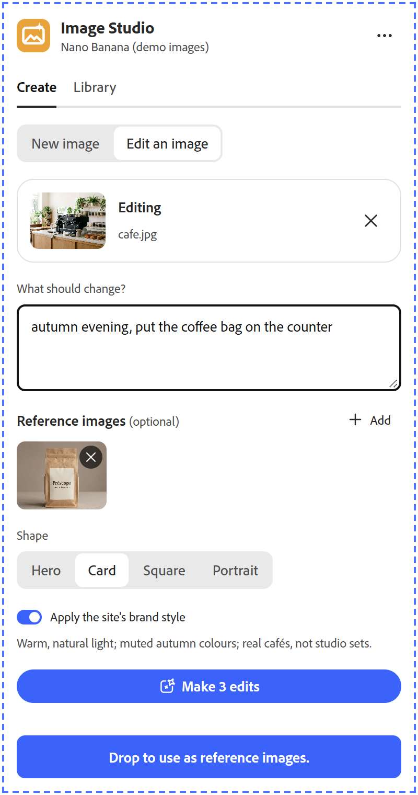
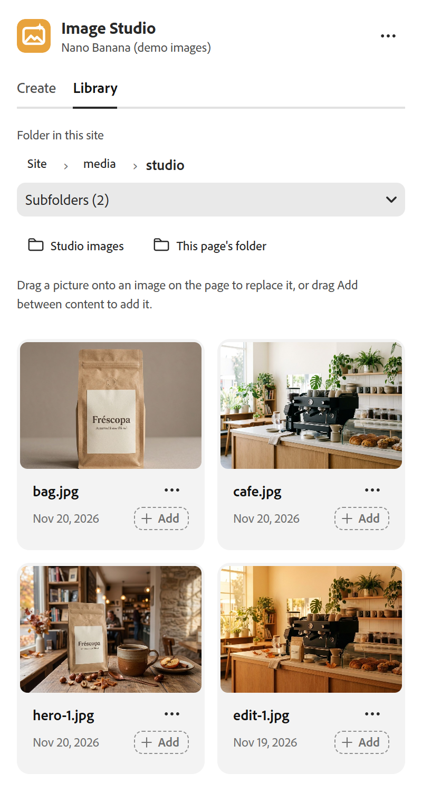
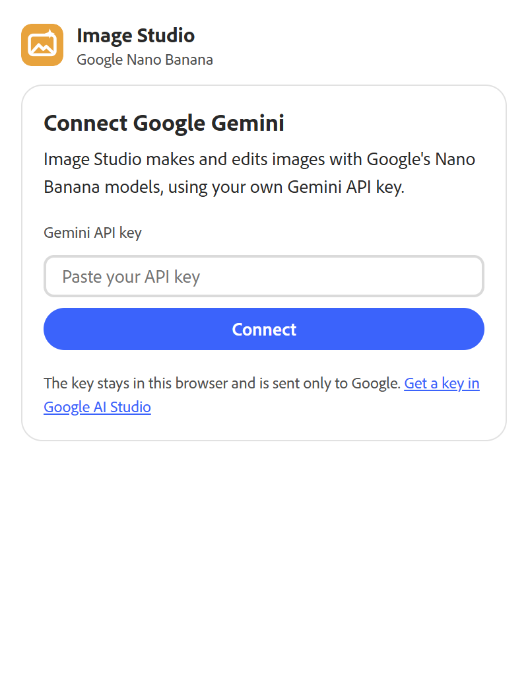

# Image Studio for Experience Workspace · Google Nano Banana

A side panel for [Adobe Experience Workspace](https://www.aem.live/docs/ew/developing/apps-plugins)
that makes and edits images for the page an author is working on, with
Google's Nano Banana (Gemini image) models, saves the good ones to the site
with alt text, and lets the author drag them onto the page.

| Reference product | Generated from the page, product kept as it is |
|---|---|
|  |  |
| **A photo already on the site** | **Edited: "autumn evening, put the coffee bag on the counter"** |
|  |  |

All four images were made with this panel's code and Nano Banana 2.

## For reviewers: try it in three minutes

1. **No setup:** [open the demo](https://main--ew-image-studio--aemxsc.aem.page/tools/studio/studio.html?demo=1).
   It uses sample images: nothing is sent to Google or saved.
2. **In Workspace:** add the library row in [Add it to a site](#add-it-to-a-site), open a page,
   choose **Panels › Image Studio** and paste a [Gemini API key](https://aistudio.google.com/app/apikey).
   Then try each of these:
   - Click into a hero or cards block. The prompt is rewritten from that block.
   - Press **Generate 3 images**, **Accept** one, then **Insert** it, drag it onto an image, or press
     **Ask chat to place it**.
   - Switch to **Edit an image**, pick a photo from the page and say what to change.
   - Drop a product shot from your desktop onto the panel to use it as a reference.
   - Open **Library** and move between folders from the path or the **Subfolders** menu.

## Feature tour

| | |
|---|---|
|  | **The prompt writes itself.** It starts from the page's heading and opening copy, or from the block the cursor is in. A hero or cards block also picks its shape. The site's brand style is added to every prompt, and authors can switch it off. |
|  | **Three options per run.** **Accept** the ones to keep, **Edit this** to refine one, or discard it. Nothing leaves the browser until it's accepted. |
|  | **Saved with alt text.** An accepted image is saved to `/media/studio/` in DA. Gemini writes its alt text, which the author can edit, or the author can mark the image decorative. Then: **Insert** at the cursor, **Replace selected** (only that image in the block changes), drag the picture onto an image, drag **+ Add** between content, or **Ask chat to place it**. |
|  | **Edit what the site already has.** Pick a photo from the page, the Library or your computer and say what should change. Add up to three **reference images**, such as a product shot, so the real product appears with its label intact. |
|  | **In Workspace.** The same step on a live page, the Fréscopa Barista Academy page. The page's own images are offered to edit, next to **From your computer** and **From the Library**. |
|  | **Drop files on the panel.** Drag image files from the desktop onto the panel to use them as references, or as the image to edit. |
|  | **Library.** The site's images, a folder at a time and newest first. Move between folders from the path or the **Subfolders** menu. Any image can be dragged onto the page, inserted, edited or used as a reference. |
|  | **The author's own key.** Each author pastes a Gemini key once. It stays in their browser and is sent only to Google. |

The *In Workspace* screenshot is from Experience Workspace. The others show the panel's real code
with the demo images, in a page that stands in for Workspace so that every button appears.

**Ask chat to place it** fills the Workspace assistant's prompt; the author checks it and sends it:

```text
Add this image to the page in the Cards block where my cursor is.
Image: https://content.da.live/aemxsc/frescopa26/media/studio/card-autumn-house-blend-hazelnut-latte-20261120-025659-1.jpg
Alt text: A bag of Fréscopa Autumn House Blend beside a mug of coffee, hazelnuts and sliced apple on a wooden café table
If an image is already there, ask me before replacing it. Change nothing else on the page.
```

The optional [chat skill](#optional-a-chat-skill-for-ask-chat-to-place-it) tells the assistant how to handle it.

## The problem

Authors get stuck on images. Stock photos look generic, and a small change to
a photo the site already has ("same shot, but autumn") means a ticket to a
designer and a wait. Suites like Optimizely and Sitecore now generate images
inside the CMS. Experience Workspace authors don't have that, and they can't
choose which model to use.

## How an author uses it

1. **Open a page and the panel.** The **Create** tab starts with a prompt
   written from the page: its heading and opening copy. With the cursor in a
   block, the prompt is written from that block instead, and a hero or cards
   block picks its usual shape. Edit it, or write your own.
2. **Make a new image or edit one.** **New image** generates from the prompt.
   **Edit an image** changes an image from the page, the Library or your
   computer ("autumn café background, warmer light") and keeps everything else.
3. **Keep the real product.** Add up to three **reference images**, such as a
   product shot, and the product appears as it really is, label included.
   Image files dropped on the panel are added as references (or become the
   image to edit, in **Edit an image** before one is picked).
4. **Pick the shape:** Hero (16:9), Card (4:3), Square or Portrait. Each run
   makes three variants. **Edit this** refines one; **Discard** drops it.
5. **Accept.** Only accepted images leave the browser: each is saved to the
   site's `/media/studio/` folder in DA with alt text written for it. The alt
   text is editable on the saved image, or switch on **Decorative image** to
   insert it with empty alt text (`alt=""`) so screen readers skip it. Insert,
   Replace selected and **+ Add** all use what you see there.
6. **Put it on the page.** Two drag handles, because Workspace decides what a
   drop does from what is dragged:
   - **The picture** (an image file): drop it on an image to replace it. The
     file carries no alt text, so the panel then offers **Add alt text** (click
     the image first; outside a block it shows the text to paste).
   - **+ Add** (the image's HTML): drop it between content to add it, with alt
     text and no second upload.

   Or use **Insert** (at the cursor) or **Replace selected** (the image selected
   on the page), both with alt text. Workspace shows only a copy cursor while
   you drag, so the panel dims the source and shows a reminder until you drop.

   Or **Ask chat to place it**: the Workspace assistant gets the image, its alt
   text and the block your cursor is in, ready for you to check and send.
7. **Library.** The **Library** tab shows the site's images a folder at a time,
   newest first. Any of them can be dragged onto the page, edited, or used as a
   reference.

## Try it without a key

[Open the demo](https://main--ew-image-studio--aemxsc.aem.page/tools/studio/studio.html?demo=1):
sample images made with Nano Banana, nothing is sent to Google or saved. Add
`?demo=1` to the library `path` to try it inside Workspace the same way.

## Before you start

- **An Experience Workspace site** (a DA site with Experience Workspace enabled).
- **A Gemini API key** for each author, from
  [Google AI Studio](https://aistudio.google.com/app/apikey). Image generation
  is billed to the key's Google Cloud project; see
  [Gemini API pricing](https://ai.google.dev/gemini-api/docs/pricing) for
  rates and free-tier limits.

## Add it to a site

1. Open the site config: `https://da.live/config#/{org}/{site}/`.
2. In the `library` sheet (add a tab called `library` if there is none), add a
   row:

   | title | path | icon |
   |---|---|---|
   | Image Studio | `https://main--ew-image-studio--aemxsc.aem.page/tools/studio/studio.html` | `https://main--ew-image-studio--aemxsc.aem.page/tools/studio/icon.svg` |

   Leave `ref`, `experience` and `format` empty.
3. Save the config.
4. Open a page of the site in Workspace and choose **Image Studio** in the
   **Panels** menu under Extensions. Each author pastes their Gemini key once.

### Optional: a brand style for every image

Add a tab called `image-studio` to the site config with `key` and `value`
columns, and a row with key `style`:

| key | value |
|---|---|
| style | Warm, natural light; muted autumn colours; real cafés, not studio sets. |

The panel adds it to every prompt. Authors can switch it off per image.

### Optional: a chat skill for Ask chat to place it

[`skills/image-studio.md`](skills/image-studio.md) tells the Workspace
assistant how to place an image the panel hands it: the given address and alt
text, only that one image changed in the block, and a question before replacing
anything. Without it the assistant still gets the prompt; the skill makes it
more careful.

Add it in the Workspace **Skills** editor (new skill, paste the file), or save
the file as `/.da/skills/image-studio.md` in the site; the Skills editor adds
the matching `skills` config row the next time it opens.

### Run your own copy

The row above loads the code from this repository, so changes here reach your
authors without review, and the code can read their Gemini key. To review
updates first, fork this repository, install
[AEM Code Sync](https://github.com/apps/aem-code-sync/installations/new) on the
fork, and use `https://main--{repo}--{owner}.aem.page/tools/studio/studio.html`
(and `icon.svg`) in the library row. There is no build step.

## What happens when

| Author action | Google | DA (the site) | The page |
|---|---|---|---|
| Generate / Make edits | The prompt, plus the edited image and references | – | – |
| Accept | The image, to write alt text | Saved to `/media/studio/{prompt-words}-{time}.jpg` | – |
| Drag the picture | – | Workspace uploads the image file next to the page | The dropped-on image replaced; **Add alt text** follows |
| Drag **+ Add** | – | – | `` with alt text, inserted where it's dropped |
| Insert / Replace selected | The image, if it has no alt text yet | – | `` with alt text |
| Ask chat to place it | The image, if it has no alt text yet | – | Nothing until the author sends the chat prompt |

## What data goes where

- **The Gemini key** stays in the author's browser, in local storage of the
  panel's web address, and is sent only to Google, in a header. It never goes
  to Adobe or into the site config. **Disconnect Google** in the **⋯** menu
  removes it.
- **Google gets** the prompt, the images used as input, and accepted images (to
  write alt text). Images the author doesn't accept are never saved anywhere.
- **Adobe's APIs** are called with the author's Workspace sign-in, only to list
  and save images in DA, read the page and read the site config. The panel only
  sends that sign-in with requests for the site's own DA files, never to Google
  or other hosts.
- **The panel page** has a Content Security Policy: scripts and styles only from
  its own site and `da.live`; network only to Google's Gemini API, DA and public
  Edge Delivery media.

## Limits

- Gemini may decline prompts or images under Google's policies; the panel says
  so. Generated images can still get details wrong; check before you publish.
- Dragging the picture sends the image file, because Workspace replaces an
  image only when a file is dropped on it. Workspace uploads that file again
  next to the page, and the drop carries no alt text: **Add alt text** writes it
  afterwards, but only once the cursor is in that block (a panel can only edit
  the block the cursor is in). **+ Add** and **Insert** reuse the saved image.
  Dragging needs a mouse or touch; **Insert** is the keyboard route.
- **Replace selected** inside a block (hero, cards…) sends the block back with
  only that image changed, so its text, links and other images stay; Workspace
  replaces whole blocks, so a lone image would wipe them. If the block has
  several images, the panel asks which one.
- **Replace selected** needs the image selected on the page and a Workspace
  version that supports replacing; otherwise insert the new image and delete the old one.
- Images on other hosts than DA or Edge Delivery can't be edited from the page.
- The Library lists one folder at a time; open subfolders from its **Subfolders** menu.

## Other image models

`tools/studio/gemini.js` is the only file that knows Gemini. Another model
(Adobe Firefly, OpenAI, a model behind your own gateway) needs an adapter with
the same three methods, passed to `mountPanel` as `modelFactory`:

| Method | Returns |
|---|---|
| `models()` | `[{ id, label }]`, the image models the key can use |
| `generate({ model, prompt, images, aspect })` | `{ mime, data }` (base64) |
| `describe(image)` | alt text, or `''` |

## Develop

```sh
npm test            # unit tests (node --test), no install needed
npm install && npm run lint   # ESLint and Stylelint with the adobe-rnd/ew-extensions config
npx @adobe/aem-cli up   # serves the panel at http://localhost:3000
```

Open `http://localhost:3000/tools/studio/studio.html?org={org}&site={site}&path=/{page}`
to run it outside Workspace (standalone mode starts after 3 seconds), or use
that address as the library `path` to load your local copy inside Workspace.

| File | What it does |
|---|---|
| `tools/studio/studio.html` | Page loaded in the side-panel iframe |
| `tools/studio/studio.js` | Waits for the Workspace SDK, falls back to standalone |
| `tools/studio/panel.js` | State, flows and rendering |
| `tools/studio/create-view.js` | The Create tab |
| `tools/studio/library-view.js` | The Library tab |
| `tools/studio/model.js` | Prompts, page reading, file names, DA paths (pure, tested) |
| `tools/studio/gemini.js` | Google Gemini adapter |
| `tools/studio/da.js` | DA: list, save and read images, page and config |
| `tools/studio/images.js` | JPEG and base64 conversion in the browser |
| `tools/studio/demo-adapter.js` | Demo mode |

## License

Apache 2.0. See [LICENSE](LICENSE).
